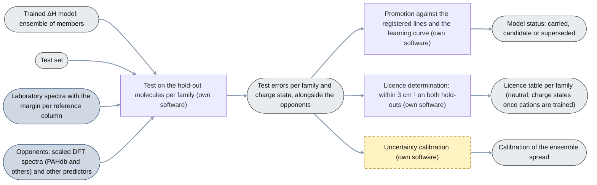

# Architecture of plan 05 (for the authors; first version 19 September 2026, English since 21 September; every sheet brought to the state of 7 October 2026, sheets 0, 1, 2, 4, 6 and 7 to that of 26 October 2026, sheet 8 to the built pipeline of 30 October 2026)

**Four kinds of diagram, kept apart (agreement of 20 September).**

| kind | what it shows | sheets |
|---|---|---|
| **Data creation** | processes that make data: the corpus step (DFT pairs and proxy correction; sheet 3) and the label factory (coupled-cluster corrections per molecule; sheet 4) | 3, 4 |
| **The ΔH model** | the components of the carried network (sheet 5); its code is `modules/05_support_predictor/m05/rungC_equivariant.py` (the equivariant body) and `m05/rungC_hybrid.py` (the pair head, the class scales, ΔH = Bᵀ ΔF B); sheet 5b is the mode-token design of 20 September, kept as module 05's baseline | 5, 5b |
| **Training and assessment** | training: from corpus records and labels comes the trained ΔH model (sheet 6); test and licence: from that model and the test set come the licence table and the calibration, with the score against the laboratory columns and the opponents (sheet 7); the weights no longer change there. The spectrum pipeline uses the trained model of sheet 6 and the table and calibration of sheet 7; on sheet 8 itself those are not drawn as input objects (agreement 20 September); the measured label is drawn there, as the second source of ΔH next to the model (agreement 20 September, evening). Sheet 6 runs per model version, not per molecule, and contains the validation loop | 6, 7 |
| **Spectrum pipeline** | a molecule in, its certified spectrum out (`m08/pipeline.py`): admission, DFT geometry and Hessian, the ΔH model's forward pass, H = H₀ + ΔH, positions, heights and profile, then the certificate — per band its family, licence, measured error and laboratory tolerance; planned: reuse of a corpus Hessian, the training-set check, the geometry term and the anharmonic step | 8 |
| **Research process** | the tests that decide whether all of this gets built this way; the only kind of sheet in which data, decisions and experiment numbers are allowed | 1, 2 |

The overview (sheet 0) shows the kinds of process and the data objects that connect them. **Numbering (20 September):** the file numbers follow the order in which the steps are traversed: first the research process that decides on the rest (1, 2), then corpus (3), labels (4), the ΔH model (5, code 5b), training (6), test and licence (7), spectrum pipeline (8). Compute location is not in yet; it comes later per box.

**Drawing rules (agreed 19–20 September; applied on all sheets).**

| rule | content |
|---|---|
| shapes | rectangle = process step; rectangle with rounded ends (grey) = data object; darker blue = external data object, not ours |
| step → object | every process step yields exactly one data object, which feeds the next step(s); a process begins and ends at a data object; branches only come out of data objects |
| naming | a step is named after the operation with the software package in brackets ("DFT (psi4)", "VPT2 (pyVPT2 on pyscf Hessians)") or "own software" / "PyTorch" when we make it; a data object is named after the thing; no word repetition between step and object; no explanation in captions |
| the model | the network is called **the ΔH model** (it predicts ΔH blocks per family); its shared part is the **body** (an equivariant message-passing network over the atoms), its output part the **pair head** (one force-constant correction per pair of primitive internal coordinates, with a learned scale per pair class); instances with different seeds are the **members** of the **ensemble**; the simple rules are the **baseline**. Trained models carry a status and a version in the model registry (ΔH-network v1.1 is carried) |
| noise principle | every derived quantity (curvature, coupling, anharmonic constant) gets an independent second route or a symmetry check, and the difference is a term of the error budget; on sheet 4 as its own step ("Consistency check"), on sheet 8 in the data object of the anharmonic constants (agreement 21 September, after the benzene VPT2: two routes to the same quartic constant differed by up to 1,265 cm⁻¹ and the package did not see it) |
| status | solid = exists and has been measured; dashed border, yellow fill = not built yet |
| none | no storage figures (cylinders), no diamonds on the target sheets (decisions per item sit inside a step), no invisible helper nodes: standard Mermaid, left to right |
| check | rendered locally before a commit (Mermaid 11), then the GitHub view |

On the research-process sheets (1, 2) their own colours apply: green = passed, blue = running, dashed = still to do, red = lost and closed; diamonds and data are allowed there. Source of truth: the `.mmd` files in this folder (Mermaid; rendered on GitHub).

## 0. Overview: the kinds of process and their data objects (`00_overview.mmd`)

```mermaid
%% Overview of plan 05 (level 1): the kinds of process and the data objects that connect them. Target architecture; no decisions, no data.
%% Rectangle = process (here: a whole sheet); rounded ends = data object; arrow = data flow. Dashed = not built yet.
%% 7 October 2026: the candidate generator (module 06) feeds the corpus as a registered source; the Spectrum Atlas publishes the catalogue with the status
%% and the provenance of every molecule; training exists (the carried ΔH model); test and licence, and the spectrum pipeline as one chain, do not yet.
flowchart LR
  linkStyle default stroke:#8a9bb0,stroke-width:2.2px
  classDef planned stroke-dasharray: 6 4,stroke:#b8860b,fill:#fff3c4,color:#111
  classDef ext fill:#cfd8e3,stroke:#3d5a80,color:#111
  classDef data fill:#e9ecef,stroke:#555,color:#111
  classDef proc fill:#f7f7fb,stroke:#333,stroke-width:1.5px,color:#111
  classDef research fill:#fdf2e3,stroke:#8a5a00,color:#111

  MOL(["Molecule: geometry, charge, multiplicity"]):::data
  COND(["Observation conditions: internal energy after UV absorption (emission) or temperature (absorption); resolution of the instrument"]):::data
  PUB(["PubChem fused aromatics, frozen set"]):::ext
  LABDB(["Laboratory spectra"]):::ext
  PAHDB(["Opponents: scaled DFT spectra (PAHdb and others) and other predictors"]):::ext
  GENF["Candidate generator (module 06)"]:::proc
  CANDS(["New fused ring systems with PubChem membership"]):::data
  LABF["Label factory (sheet 4)"]:::proc
  LABELS(["Label: ΔH blocks with error margin per family and geometry term per mode, sealed"]):::data
  CORPF["Corpus step (sheet 3)"]:::proc
  CORPUS(["Corpus records: two DFT Hessians, proxy correction, local-coordinate features and deck responses per molecule"]):::data
  ATLASF["Atlas export (website)"]:::proc
  ATLAS(["Spectrum Atlas: catalogue with status and provenance per molecule"]):::data
  TRAIN["Training (sheet 6)"]:::proc
  TRAINED(["Trained ΔH model: ensemble of members"]):::data
  TESTSET(["Test set"]):::data
  EVAL["Test and licence (sheet 7)"]:::planned
  LICCAL(["Licence table and calibration"]):::data
  PIPE["Spectrum pipeline (sheet 8)"]:::planned
  SPEC(["Spectrum: bands with position, intensity, profile and error margin; licence status per family"]):::data
  RES["Research process (sheets 1 and 2)"]:::research

  PUB --> GENF --> CANDS --> CORPF
  MOL --> LABF --> LABELS
  MOL --> CORPF --> CORPUS
  CORPUS --> ATLASF
  LABELS --> ATLASF --> ATLAS
  LABELS --> TRAIN
  CORPUS --> TRAIN
  TRAIN --> TRAINED
  TRAINED --> EVAL
  TRAIN --> TESTSET --> EVAL
  LABDB --> EVAL
  PAHDB --> EVAL
  EVAL --> LICCAL
  MOL --> PIPE
  LABELS --> PIPE
  COND --> PIPE
  TRAINED --> PIPE
  LICCAL --> PIPE
  PIPE --> SPEC
  RES -. decides on .-> LABF
  RES -. decides on .-> TRAIN
  RES -. decides on .-> EVAL
  RES -. decides on .-> PIPE
```

# Research process (may contain data and decisions)

## 1. Research process — the label factory (`10_research_process_label_factory.mmd`; pipeline B in the proposal)

```mermaid
%% Research process — the label factory (in the proposal: pipeline B): the tests that decide whether the target architecture of sheet 4 gets built; the end object is the licensed factory design with the first labels as evidence, not the label set (sheet 4 makes that). Status 26 October 2026.
%% This sheet may contain data and decisions. Green = passed; blue = running; dashed = still to do; red = failed and closed.
%% 26 October 2026: anchor set three and the DF-MP2 step (eleven carried anchors), LNO closed, decision 63 (no new CC anchors before July 2027), the kernel race fixed, the cation anchor's blocker named.
flowchart LR
  linkStyle default stroke:#8a9bb0,stroke-width:2.2px
  classDef done fill:#d9f0dc,stroke:#2e7d32,color:#111
  classDef running fill:#dbe9ff,stroke:#2a5db0,color:#111
  classDef todo stroke-dasharray: 6 4,stroke:#b8860b,fill:#fff3c4,color:#111
  classDef closed fill:#f6d5d5,stroke:#a33,color:#111
  classDef dec fill:#eee,stroke:#444,color:#111
  classDef data fill:#e9ecef,stroke:#555,color:#111

  M1["Frozen local spaces are smooth; couplings exact from 2k+1 gradients (benzene, naphthalene; 5–19 Sep)"]:::done
  M2B["Borrowed LNO gradient engine: does not compute our quantity, does not fit in 32 GB (17–19 Sep)"]:::closed
  E8["Canonical CCSD(T) Hessians by central differences of analytic gradients over the symmetry-unique displacements (late September)"]:::done
  FROZ["Naphthalene at an inherited frozen core of 6: invalid; frozen core derived from the elements since (27 Sep)"]:::closed
  LAMB["Lambda incident: gradients with the CCSD lambda; every earlier CC Hessian invalid (29 Sep)"]:::closed
  FIX["(T) lambda solved explicitly, (T) density and lambda kernels in C, water acceptance gate; pyscf PRs #3469, #3470, #3477 (29 Sep – 3 Oct)"]:::done
  RACE["OpenMP race in our (T) kernels, found in the maintainer's review commit: fixed and re-verified on water and formaldehyde (23 Oct)"]:::done
  DZ4["Four cc-pVDZ anchors: benzene, fluorobenzene, pyridine, naphthalene (30 Sep – 2 Oct)"]:::done
  CAT["Benzene⁺ (UHF) on a 32 GB box: out of memory (30 Sep)"]:::closed
  ANT["Anthracene cc-pVDZ: imaginary out of plane (51i cm⁻¹), the small-basis arene artefact (6 Oct)"]:::done
  TZB["Full benzene cc-pVTZ anchor: cc-pVDZ is 25 / 138 / 70 / 41 cm⁻¹ off per family (6 Oct)"]:::done
  T1["Test 1: MP2 tracks the CCSD(T) basis step on three coordinates (0.89–0.97), B3LYP does not (4 Oct)"]:::done
  T2["Test 2: composite CC/DZ + [MP2/TZ − MP2/DZ] within 3.3 / 4.4 / 7.3 / 3.3 cm⁻¹ of CC/TZ (6 Oct)"]:::done
  T3R["Test 3: anthracene repaired out of plane, 86 / 115 cm⁻¹ against ωB97X 105 / 126 (7 Oct)"]:::done
  POL["Energy route on every anchor (decision 61); anchor registry, one carried version per molecule (decision 62) (6–7 Oct)"]:::done
  MP2Q["MP2 basis step for every cc-pVDZ anchor: six carried TZ-tier anchors; chain 33c: out-of-plane error halved on 4 of 4 (7 Oct)"]:::done
  S3W["Anchor set three: quinoxaline, quinoline, isoquinoline, azulene, acenaphthylene at CCSD(T)/cc-pVDZ, each with its CC APT (13–20 Oct)"]:::done
  DFMP["DF-MP2 basis step (psi4): analytic gradient against finite differences on water 4.9e-8, density fitting moves ≤ 0.46 cm⁻¹; adopted (19–20 Oct)"]:::done
  CAR11["Eleven carried composite anchors in the registry (20 Oct)"]:::done
  D1{"Composite within the per-family lines on a heteroatom and a larger molecule?"}:::dec
  ADD["Additivity checks: pyridine at cc-pVTZ, a QZ step on benzene"]:::todo
  LNO["LNO curvatures at xtight within 0.27 % of canonical on three coordinates, but the out-of-plane offset does not shrink and frozen spaces are worse: route closed (8–9 Oct)"]:::closed
  D2{"Full anchor above the top rung affordable? Pyrene 4–5 CCX53 days, perylene 20–36 (price note, 8 Oct)"}:::dec
  END63["Decision 63: no new CC anchors before July 2027; the anchor plan and its price go to the supervisor (17 Oct)"]:::done
  CANON["Full anchors up to anthracene–pyrene (24–26 atoms), canonical with the MP2 step — after June 2027"]:::todo
  BIG["Spot-check anchors above 26 atoms at rule-chosen coordinates, a test of the network (TASKS 36) — after June 2027"]:::todo
  CATN["Cation anchors: pyscf's unrestricted (T) density does not fit at this size; a blocked UHF (T) density first (design note, 23 Oct)"]:::todo
  OUT(["Licensed factory design: anchor level per family (composite with the DF-MP2 basis step), error budget per family, eleven carried anchors with their checks; a cation anchor still open"]):::data

  M1 --> M2B --> E8
  E8 --> FROZ --> FIX
  E8 --> LAMB --> FIX --> DZ4 --> TZB --> T2
  FIX --> RACE --> OUT
  DZ4 --> CAT --> CATN
  FIX --> ANT --> T3R
  T1 --> T2 --> T3R --> MP2Q --> S3W --> DFMP --> CAR11 --> D1
  POL --> MP2Q
  D1 -- yes --> OUT
  D1 -- not yet --> ADD --> D1
  M2B --> LNO --> D2 --> END63
  END63 -- up to pyrene --> CANON --> OUT
  END63 -- above --> BIG --> OUT
  CATN --> OUT
```

## 2. Research process — the ΔH model (`20_research_process_deltaH_model.mmd`; pipeline A in the proposal)

```mermaid
%% Research process — the ΔH model (in the proposal: pipeline A): the tests that decide whether and how the ΔH model of sheets 5 and 6 gets built; the end object is the licensed model design with the first licence table, not the trained model (sheet 6 makes that). Status 26 October 2026.
%% This sheet may contain data and decisions. Green = passed or measured; blue = running; dashed = still to do; red = lost and closed.
%% 26 October 2026: chains 35h2–44, the coverage, size, form and cation reads, set three and the proxy check (the whole head), the scale-factor comparison; the next carried version collects them.
flowchart LR
  linkStyle default stroke:#8a9bb0,stroke-width:2.2px
  classDef done fill:#d9f0dc,stroke:#2e7d32,color:#111
  classDef running fill:#dbe9ff,stroke:#2a5db0,color:#111
  classDef todo stroke-dasharray: 6 4,stroke:#b8860b,fill:#fff3c4,color:#111
  classDef closed fill:#f6d5d5,stroke:#a33,color:#111
  classDef dec fill:#eee,stroke:#444,color:#111
  classDef data fill:#e9ecef,stroke:#555,color:#111

  LA["Layer A: 45 molecules, DFT pairs; the family block is the target object (18–19 Sep)"]:::done
  TOK["Mode tokens, contrastive embeddings, skip-gram on the coupling matrix: lost on 45 molecules (19 Sep)"]:::closed
  E7["E7: couplings unlearnable in the mode basis; learned in local coordinates (decision 49, 23 Sep)"]:::done
  CORP["Corpus of 847 molecules (layers A, A2, B); analytic second route on 36 (Sep – Oct)"]:::done
  RB["Rung B: pairwise local head on primitive-pair features (measured on 175)"]:::done
  RC["Rung C: equivariant body; element incident fixed; hybrid pair head with SQM-like class scales (28 Sep – 1 Oct)"]:::done
  T1A["T1 on the all-mode average met at 750: ratio ≤ 0.25, corrected ω ≤ 3 cm⁻¹ on unseen parents (2 Oct)"]:::done
  FAM["Decision 53: every family under 3 cm⁻¹; chain 34 (family-balanced K-diagonal term) carried as v1.1 (3–4 Oct)"]:::done
  ANL["Analytic hold-out labels: ring-ip 1.82, CH-stretch 1.25, CH-oop 2.36 met; other 3.35 open (5 Oct)"]:::done
  W["Loss weighting for the low modes (chains 34b, 34c): no response (4 Oct)"]:::closed
  HNG["Hinge input for the low modes (chain 36): rejected, other-low 3.21 → 3.51 (7 Oct)"]:::closed
  STONE["MP2 as the proxy target: priced out for the pool (6 Oct)"]:::closed
  SCF["Against scale factors: on hold-out (a) the network beats one-, two- and three-region factors in every family (25 Oct)"]:::done
  LBL["Analytic training labels for the pool: 775 of 811 on the labels server (from 7 Oct)"]:::running
  C35H["Chain 35h2, half read on 586 analytic labels: lower on every quantity of both hold-outs, other 3.45 → 3.11 (17 Oct)"]:::done
  C35["Chain 35: the full read on every analytic label, armed for the labels' end (26 Oct)"]:::todo
  D1{"other-low ≤ 2.5 cm⁻¹ on the hold-out?"}:::dec
  RNG["Range: a 6 Å cutoff (step 0: up to 1.2 of 1.95 cm⁻¹)"]:::todo
  VOL["Data volume pays at fixed composition: corrected ω 2.13× lower per decade on (a) (15 Oct)"]:::done
  C37["Chain 37: 200 more molecules are count, not coverage: (b) 0.330 → 0.325 (8 Oct)"]:::closed
  C38["Chain 38: the five-membered-ring families cover hold-out (b): without them 0.410 against 0.317 (9 Oct)"]:::done
  C40["Chain 40: thirty five-ring children per family, (b) 0.310 against 0.325: stop, by 0.0005 (17 Oct)"]:::closed
  C40B["Chain 40b: about 45 per family; read open"]:::todo
  C39["Chain 39: trained on ≤ 20 atoms, twice the error on ≥ 27 atoms (q 1.96); size and ring count confounded (9 Oct)"]:::done
  C41["Chain 41: five fused rings from a corpus of at most four, q5 = 1.05: size alone is no wall up to 40 atoms (19 Oct)"]:::done
  C42["Chain 42: the mandate's four shape molecules, 34–60 atoms (after lever 5)"]:::todo
  C43["Chain 43: rung 4's learning curve, tetracene held out"]:::todo
  FLOOR["The carried head's form is not the limit; its projected target grows with size (15 Oct)"]:::done
  C44["Chain 44: projected against ridge target"]:::todo
  CATG["Cation gate, FD against analytic: not passed (CH-oop 3.05, other 2.27 against 1.5); every cation analytic (9 Oct)"]:::closed
  CATL["Cation labels: phases 1–2 on the laptop, fourteen on the labels server (from 9 Oct)"]:::running
  PAR["σ_h broken by the hybrid head on mixed-parity pairs; a parity-odd factor built, off until the next version (13 Oct)"]:::done
  V12["Next carried version: analytic training labels, five-ring and cation rows, the parity factor, more data (TASKS 129)"]:::todo
  T3A["T3: proxy model fine-tuned on three cc-pVDZ anchors, about 6 cm⁻¹ in plane on the held-out anchor (2 Oct)"]:::done
  C33["Chain 33: anthracene as fifth anchor, naphthalene 6.52 → 5.83 cm⁻¹; out of plane mixed levels (7 Oct)"]:::done
  C33C["Chain 33c: T3 on composite (cc-pVTZ-tier) anchors, out-of-plane error halved on 4 of 4 (7 Oct)"]:::done
  D2{"Out-of-plane transfer improves on ≥ 3 of 4 common anchors?"}:::dec
  S3["Anchor set three, registered read (λ = 1): flat, R-A CH-oop 14.06 → 13.69, R-B 0 of 3 (20 Oct)"]:::closed
  DIAG["Diagnosis: the last layer cannot fit the CC out-of-plane correction even in sample (7.76), the whole head can (0.80) (21 Oct)"]:::done
  WH["Whole head, repeated read: R-A −13.8 %, R-B 3 of 3, as predicted (21 Oct)"]:::done
  PX["Few-anchor proxy check: the whole head gains along the anchor count, λ = 1 does not (arm a, 22 Oct)"]:::done
  FIT["The whole head is the transfer's fit mode (26 Oct)"]:::done
  NET["Out-of-plane transfer limited by the network: the input design comes first"]:::todo
  LIC["Licence per family against the lines; ensemble, calibration"]:::todo
  OUT(["Licensed model design: target object (family block), representation with which every family learns, number of labels needed per family, pre-training recipe on the corpus; first licence table per family"]):::data

  LA --> TOK
  LA --> E7 --> RB --> RC
  CORP --> RB
  RC --> T1A --> FAM --> ANL
  ANL --> W
  ANL --> HNG
  ANL --> STONE
  ANL --> SCF --> LIC
  ANL --> LBL --> C35H --> C35 --> D1
  D1 -- yes --> V12
  D1 -- no --> RNG --> V12
  FAM --> VOL --> V12
  FAM --> C37 --> C38 --> C40 --> C40B --> V12
  RC --> C39 --> C41 --> C42 --> V12
  C41 --> C43 --> V12
  RC --> FLOOR --> C44 --> V12
  FAM --> CATG --> CATL --> V12
  RC --> PAR --> V12
  T1A --> T3A --> C33 --> C33C --> D2
  D2 -- yes --> S3 --> DIAG --> WH --> PX --> FIT --> LIC
  D2 -- no --> NET --> LIC
  V12 --> LIC
  LIC --> OUT
```

# Target architecture (no data, no decisions)

## 3. Data creation — the corpus (`30_data_creation_corpus.mmd`)

```mermaid
%% Data creation — the corpus: two DFT Hessians per molecule and the proxy correction (level 3). Target architecture.
%% Rectangle = process step (operation + software); rounded ends = data object (the thing). Every step yields one data object. Dashed = not built yet.
%% 7 October 2026: the molecules come from a manifest with a source per row (parents by hand, enumerated children, Hessian-QM9, pool 3, the candidate
%% generator of module 06 with its gate); what is computed next is chosen by the composition rule. The two Hessians are analytic (pyscf) — the
%% finite-difference psi4 Hessians of the first layers stay in the record as the first route and are being replaced pool-wide. The record keeps the Cartesian
%% Hessians, the modes, the local-coordinate features and the probe deck's pattern responses (the mode tokens of 6 September were dropped by decision 49).
%% 9 October 2026, the cheap level's reach (measured): both DFT Hessians by finite differences (psi4, 6-31G*, 8 threads of a CPX62) take 4.0 h for
%% perylene (32 atoms), 5.3 h for a 33-atom, 6.6 h for a 35-atom and 7.6 h for a 38-atom molecule of pool 3; the analytic route (pyscf, the labels
%% server) takes 6,000–14,000 s per functional at 30 atoms. So the corpus can hold the large families themselves (≈ 40 atoms); chain 39 (9 Oct) showed
%% that it has to — the network does not carry the correction across a large gap in size and ring count.
flowchart LR
  linkStyle default stroke:#8a9bb0,stroke-width:2.2px
  classDef planned stroke-dasharray: 6 4,stroke:#b8860b,fill:#fff3c4,color:#111
  classDef data fill:#e9ecef,stroke:#555,color:#111
  classDef ext fill:#cfd8e3,stroke:#3d5a80,color:#111

  SRCX(["Parent molecules, Hessian-QM9, pool 3"]):::ext
  PUB(["PubChem fused aromatics, frozen set"]):::ext
  ENUM["Enumeration of substituted children (RDKit)"]
  KIDS(["Enumerated children of the parent cores"]):::data
  GEN["Candidate generation and gate (module 06; PyTorch, RDKit)"]
  CANDS(["New fused ring systems with PubChem membership"]):::data
  MAN["Manifest assembly with a source per row (own software)"]
  MANI(["Manifest: molecule, layer, source, status"]):::data
  SEL["Selection by the composition rule (own software)"]
  MOL(["Molecule: SMILES or geometry, charge, multiplicity"]):::data
  OPT["Geometry optimisation at low level (psi4)"]
  GEO(["Optimised geometry"]):::data
  DFTL["Analytic Hessian at low level, B3LYP (pyscf)"]
  SK(["Hessian H0 and dipole derivatives"]):::data
  DFTH["Analytic Hessian at high level, ωB97X (pyscf)"]
  H1(["Hessian H1"]):::data
  MODE["Mode analysis (own software)"]
  MODES(["Normal modes: L, frequencies, families, symmetry blocks"]):::data
  PROXY["Proxy correction (own software)"]
  DHP(["Proxy correction: ΔH = H1 − H0 (Cartesian), with its projections on the modes and on the primitive-pair coordinates"]):::data
  LOCC["Local-coordinate features (own software, geomeTRIC)"]
  PF(["Primitive internal coordinates and their pairs — diagonal, atom-sharing, ring bond–bond — with pair features from H0"]):::data
  DECK["Deck responses (own software)"]
  RESP(["Pattern responses R = ½ aᵀ ΔH a of the probe deck: the measurement planner's records"]):::data
  REC["Record assembly (own software)"]
  CORP(["Corpus records: two DFT Hessians, proxy correction, local-coordinate features and deck responses per molecule"]):::data

  SRCX --> ENUM --> KIDS --> MAN
  PUB --> GEN --> CANDS --> MAN
  SRCX --> MAN --> MANI --> SEL --> MOL
  MOL --> OPT --> GEO
  GEO --> DFTL --> SK --> MODE --> MODES
  GEO --> DFTH --> H1
  SK --> PROXY
  H1 --> PROXY
  MODES --> PROXY --> DHP --> REC
  GEO --> LOCC
  SK --> LOCC --> PF --> REC
  DHP --> DECK
  MODES --> DECK --> RESP --> REC
  SK --> REC
  REC --> CORP
```

**The cheap level's reach (9 October 2026).** The corpus level is DFT (B3LYP and ωB97X, 6-31G*), and it reaches the sizes the mandate needs: on one
CPX62 runner (8 threads) both finite-difference Hessians took 4.0 h for perylene (32 atoms), 5.3 h for benzo[a]pyrene+SH (33), 6.6 h for
benzo[k]fluoranthene+CF3 (35) and 7.6 h for dibenz[a,h]anthracene+CHO (38) — pool 3's runner logs. The analytic route on the labels server takes
6,000–14,000 s per functional at 30 atoms. Coupled-cluster anchors stop at 24–26 atoms (pyrene: 4–5 CCX53 days); above them the network carries
the correction, and chain 39 (9 Oct) showed that it can do so only for the families the corpus contains: trained on molecules of ≤ 20 atoms (one-
and two-ring scaffolds) its error on ≥ 27-atom molecules is twice that of a control trained across sizes. Chain 41 (19 Oct) showed the other
side: with ring systems of up to four fused rings in the corpus, five-ring molecules of 32–40 atoms are predicted about as well as with
five-ring molecules in training (q5 = 1.05). The corpus therefore holds the large families themselves, at the DFT level, up to ≈ 40 atoms.

## 4. Data creation — the label factory: how one label comes about (`40_data_creation_labels.mmd`)

```mermaid
%% Data creation — the label factory: how one label comes about (level 3). Target architecture: no decisions, no data.
%% Rectangle = process step (operation + software); rounded ends = data object (the thing). Every step yields one data object. Dashed = not built yet.
%% 7 October 2026: redrawn to the built route. A label is a canonical CCSD(T) Hessian by central differences of analytic gradients over the symmetry-unique
%% displacements, raised to cc-pVTZ quality by the MP2 basis step (the composite level), checked by two routes per quantity and kept in the anchor registry
%% (one carried version per molecule). The open-shell gradients are the planned branch for cations; the deck-transport route of September is
%% replaced by the full symmetric deck.
%% 26 October 2026: the local-correlation (LNO) route is gone (its out-of-plane offset does not shrink); the MP2 basis step is psi4's
%% density-fitted MP2 gradient.
flowchart LR
  linkStyle default stroke:#8a9bb0,stroke-width:2.2px
  classDef planned stroke-dasharray: 6 4,stroke:#b8860b,fill:#fff3c4,color:#111
  classDef data fill:#e9ecef,stroke:#555,color:#111

  MOL(["Molecule: geometry, charge, multiplicity"]):::data
  SK(["Hessian H0 and dipole derivatives"]):::data
  SYM["Symmetry analysis (own software)"]
  DECK(["Deck: symmetry-unique Cartesian displacements"]):::data
  CCG["CCSD(T) gradients with relaxed density (pyscf, own (T) kernels in C)"]
  GRADS(["Gradients, energies and dipoles at every displacement"]):::data
  OPEN["UCCSD(T) gradients for open shell (pyscf, own unrestricted (T) kernels)"]:::planned
  OPENG(["Open-shell gradients, energies and dipoles at every displacement"]):::data
  FD["Central differences and symmetry reconstruction (own software)"]
  HCC(["CCSD(T)/cc-pVDZ Hessian and dipole derivatives"]):::data
  MP2["DF-MP2 gradients in two basis sets (psi4)"]
  MROWS(["MP2 Hessian rows, cc-pVDZ and cc-pVTZ"]):::data
  COMP["Composite assembly (own software)"]
  HCOMP(["Composite Hessian: CCSD(T)/cc-pVDZ plus the MP2 basis step"]):::data
  DIFF["Difference to the cheap level (own software)"]
  DH(["ΔH blocks per family: diagonal and couplings"]):::data
  CHECK["Consistency check (own software)"]
  NOISE(["Noise term per quantity: difference between two routes or between symmetry partners"]):::data
  BUDGET["Error budget (own software)"]
  MARG(["Error margin per family: noise and additivity error of the composite"]):::data
  CUB(["Cubic constants of the low level (from the VPT2 step of sheet 8)"]):::data
  GEO["Geometry term (own software)"]:::planned
  GTERM(["Geometry term per mode"]):::data
  SEAL["Sealing and registration (own software)"]
  LABEL(["Label: ΔH blocks with error margin per family and geometry term per mode, sealed"]):::data

  MOL --> SYM --> DECK
  DECK --> CCG --> GRADS --> FD
  DECK --> OPEN --> OPENG --> FD
  FD --> HCC --> COMP
  DECK --> MP2 --> MROWS --> COMP
  COMP --> HCOMP --> DIFF
  SK --> DIFF --> DH --> SEAL
  GRADS --> CHECK
  HCC --> CHECK
  MROWS --> CHECK
  CHECK --> NOISE --> BUDGET
  DH --> BUDGET --> MARG --> SEAL
  GRADS --> GEO
  CUB --> GEO --> GTERM --> SEAL
  SEAL --> LABEL
```

## 5. Components of the ΔH model (`50_deltaH_model_components.mmd`)

```mermaid
%% Components of the ΔH model (level 4): what happens inside the step "Forward pass (ΔH model, PyTorch)" of sheet 8 (the spectrum pipeline).
%% Rectangle = process step (operation + software); rounded ends = data object (the thing). Every step yields one data object. Dashed = not built yet.
%% 7 October 2026: redrawn to the carried design (the hybrid model, ΔH-network v1.1, chain 34). An equivariant body turns atoms, positions, charge state and
%% the rotation invariants of H0 into per-atom features; a pair head predicts one force-constant correction per pair of primitive internal coordinates on a
%% fixed pattern, from the features of the atoms involved, the pair features and the cheap force constants; a learned scale per pair class adds a share of
%% the cheap force constant (SQM-like); ΔH = Bᵀ ΔF B is exactly symmetric and translation- and rotation-free. The tensor head (Cartesian 3×3 blocks) and the
%% stand-alone pairwise head of rungs B and C remain in the code as measured variants, not in the carried design.
flowchart LR
  linkStyle default stroke:#8a9bb0,stroke-width:2.2px
  classDef planned stroke-dasharray: 6 4,stroke:#b8860b,fill:#fff3c4,color:#111
  classDef data fill:#e9ecef,stroke:#555,color:#111

  GEO(["Molecule: atomic numbers, coordinates of the cheap minimum, charge, multiplicity"]):::data
  SK(["Hessian H0 of the cheap level"]):::data
  PRIMC["Primitive internal coordinates and the pair pattern (geomeTRIC, own software)"]
  PRIM(["Primitive pairs of the pattern, Wilson B matrix, cheap force constants F0 per pair"]):::data
  FEAT["Pair features (own software)"]
  PF(["Pair features: pair classes, ring relations, projections of H0"]):::data
  EQB["Equivariant body: message passing over atoms with scalar and vector channels, charge-state embedding, fed by the rotation invariants of H0 (PyTorch)"]
  ATOMF(["Per-atom scalar and vector features"]):::data
  HEAD["Pair head: pooled atom features of the two primitives, pair features, F0 (PyTorch)"]
  DFR(["ΔF residual per primitive pair"]):::data
  SQM["Class scaling: ΔF = α per pair class × F0 + residual (PyTorch)"]
  DFL(["ΔF: force-constant correction per primitive pair"]):::data
  BACK["Back-transformation ΔH = Bᵀ ΔF B (own software)"]
  DHC(["ΔH in Cartesian coordinates of one member"]):::data
  PROJ["Projection onto the cheap modes: Lᵀ ΔH L (own software)"]
  KLOC(["ΔH blocks per family of one member, couplings included"]):::data
  ENSA["Ensemble averaging over the members (own software)"]:::planned
  OUT(["ΔH blocks per family, with ensemble uncertainty"]):::data

  GEO --> PRIMC --> PRIM
  PRIM --> FEAT
  SK --> FEAT --> PF --> HEAD
  GEO --> EQB
  SK --> EQB --> ATOMF --> HEAD
  PRIM --> HEAD --> DFR --> SQM
  PRIM --> SQM --> DFL --> BACK
  PRIM --> BACK --> DHC --> PROJ --> KLOC --> ENSA --> OUT
```

## 5b. The ΔH model in code (`51_deltaH_model_pytorch.py`)

Sheet 5b is the mode-token design of 20 September in PyTorch (input layer `TokenEmbedding`, a two-layer Transformer `Backbone`, a `BlockHead` for the ΔH block per family in the mode basis, a `PairHead` for the support of mode pairs, losses, ensemble, smoke test). Decision 49 (23 September) moved the couplings into local coordinates, and the design is no longer the ΔH model; it stays as module 05's pre-registered baseline for the diagonal and is copied verbatim to `m05/deltah_model.py` by `m05/sync_model.py`. The carried ΔH model (sheet 5) is code in `m05/rungC_equivariant.py` and `m05/rungC_hybrid.py`; in its carried configuration (sum aggregation, three blocks, width 64, pair head hidden 256, 66 pair features) it has 304,276 parameters, 384 of them the hinge-class rows that stay at zero unless `--hinge-feature` is given.

## 6. Training (`60_training.mmd`)

```mermaid
%% Training (level 3): from corpus records and labels comes the trained ΔH model. Target architecture. The assessment (test, licence, calibration) is on sheet 7.
%% Rectangle = process step (operation + software); rounded ends = data object (the thing). Every step yields one data object. Dashed = not built yet.
%% 7 October 2026: redrawn to the built route — training on the proxy correction with early stopping on an inner validation split, fine-tuning of the head
%% and the class scales on the anchor labels with leave-one-anchor-out validation, every saved model registered with a status and a version; reads run
%% only on carried models. The ensemble over seeds is read as seed means; an ensemble object with spread is not built yet.
%% 26 October 2026: the fine-tune trains every layer of the head with the class scales (the last layer alone could not fit the CC
%% out-of-plane correction).
flowchart LR
  linkStyle default stroke:#8a9bb0,stroke-width:2.2px
  classDef planned stroke-dasharray: 6 4,stroke:#b8860b,fill:#fff3c4,color:#111
  classDef data fill:#e9ecef,stroke:#555,color:#111

  CORP(["Corpus records: two DFT Hessians, proxy correction, local-coordinate features and deck responses per molecule"]):::data
  LAB(["Label: ΔH blocks with error margin per family and geometry term per mode, sealed"]):::data
  SPLIT["Split per molecule and per scaffold family, hold-outs fixed in advance (own software)"]
  SETS(["Training, validation and test sets"]):::data
  PRE["Training on the proxy correction with early stopping (PyTorch)"]
  PRENET(["Proxy-trained ΔH model"]):::data
  FT["Fine-tuning of the whole head and the class scales on the labels (PyTorch)"]
  FTNET(["Fine-tuned ΔH model"]):::data
  VAL["Leave-one-anchor-out validation (own software)"]
  VALR(["Transfer errors per family on held-out anchors"]):::data
  ENSF["Ensemble formation over seeds (PyTorch)"]:::planned
  MEMB(["Ensemble of members"]):::data
  REG["Registration with status and version (own software)"]
  ENS(["Trained ΔH model: ensemble of members"]):::data

  CORP --> SPLIT
  LAB --> SPLIT
  SPLIT --> SETS
  SETS --> PRE --> PRENET --> FT --> FTNET --> ENSF --> MEMB --> REG --> ENS
  SETS --> FT
  FTNET --> VAL --> VALR --> FT
```

## 7. Test and licence (`70_test_and_licence.mmd`)

## 8. Spectrum pipeline (`80_spectrum_pipeline.mmd`)

```mermaid
%% Spectrum pipeline (level 3): a molecule in, its certified infrared spectrum out. As built: modules/08_industry_synthesis/m08/pipeline.py, pipeline 0.4 (versions in modules/PIPELINE.md).
%% Rectangle = process step (operation + software); rounded ends = data object (the thing). Every step yields one data object. Dashed = not built yet.
%% 30 October 2026: brought to the built pipeline (TASKS 153). The licence enters at the certificate, per family and band (decision 65), not as a filter on ΔH
%% blocks: the whole ΔH is applied and every band says whether its family is licensed. A measured label (sheet 4) is not a ΔH source here, and observation
%% conditions (temperature, emission) are later work (TASKS 11). Planned: reuse of a corpus Hessian (TASKS 150), the training-set check (TASKS 155), the
%% geometry term and the anharmonic step (TASKS 53).
flowchart LR
  linkStyle default stroke:#8a9bb0,stroke-width:2.2px
  classDef planned stroke-dasharray: 6 4,stroke:#b8860b,fill:#fff3c4,color:#111
  classDef data fill:#e9ecef,stroke:#555,color:#111

  MOL(["Molecule: SMILES, neutral and closed shell"]):::data
  ADM["Admission (own software, RDKit)"]
  ADMM(["Admitted molecule: canonical SMILES, start geometry, carried members"]):::data
  OPT["Geometry optimisation (DFT, psi4)"]
  GEO(["Optimised geometry"]):::data
  DFT["Hessian and dipole derivatives (DFT, pyscf, analytic)"]
  CORP(["Corpus records: Hessians and dipole derivatives of computed molecules"]):::data
  REUSE["Reuse in the canonical atom order (own software)"]:::planned
  SK(["Hessian H0 and dipole derivatives"]):::data
  MODE["Mode analysis (own software)"]
  MODES(["Normal modes: L, frequencies, families"]):::data
  LOCC["Local-coordinate features (own software, geomeTRIC)"]
  PF(["Primitive pairs with their features; atoms and coordinates"]):::data
  FWD["Forward pass (ΔH model: equivariant body and hybrid pair head, ΔH = Bᵀ ΔF B; PyTorch)"]
  DH(["ΔH of each member and their mean"]):::data
  APPLY["Assembly of H (own software)"]
  H(["Force constants H = H0 + ΔH"]):::data
  EIG["Diagonalisation (own software)"]
  POS(["Band positions with the members' range"]):::data
  INT["Intensity calculation, double harmonic (own software)"]
  INTS(["Band heights"]):::data
  VPT["VPT2 (pyVPT2 on pyscf Hessians)"]:::planned
  ANHC(["Anharmonic constants, with route difference per constant"]):::data
  GEOP["Geometry term (own software)"]:::planned
  POSG(["Band positions with geometry term"]):::data
  ANH["Anharmonic correction (own software)"]:::planned
  ANHS(["Anharmonic shifts per band, overtones and combination bands"]):::data
  SHAPE["Profile formation (own software)"]
  SPEC0(["Spectrum: bands with position, height and Lorentzian profile"]):::data
  TSET(["Training set of the carried members"]):::data
  TCHK["Training-set check (own software)"]:::planned
  TFLAG(["Trained on or unseen, with the ωB97X truth where the corpus holds it"]):::data
  LICT(["Licence table and measured errors per family (sheet 7)"]):::data
  LTOL(["Laboratory tolerance per spectral region"]):::data
  CERT["Certificate (own software)"]
  SPEC(["Certified spectrum: per band position, height, members' range, family, licence, measured error, laboratory tolerance"]):::data

  MOL --> ADM --> ADMM --> OPT --> GEO --> DFT --> SK
  ADMM --> REUSE
  CORP --> REUSE --> SK
  SK --> MODE --> MODES
  SK --> LOCC --> PF --> FWD --> DH --> APPLY --> H --> EIG --> POS --> SHAPE
  MODES --> FWD
  ADMM --> FWD
  SK --> APPLY
  H --> INT
  SK --> INT --> INTS --> SHAPE
  SK --> VPT --> ANHC
  POS --> GEOP --> POSG --> SHAPE
  ANHC --> GEOP
  ANHC --> ANH --> ANHS --> SHAPE
  MODES --> ANH
  SHAPE --> SPEC0 --> CERT --> SPEC
  ADMM --> TCHK
  TSET --> TCHK --> TFLAG --> CERT
  MODES --> CERT
  LICT --> CERT
  LTOL --> CERT
```

